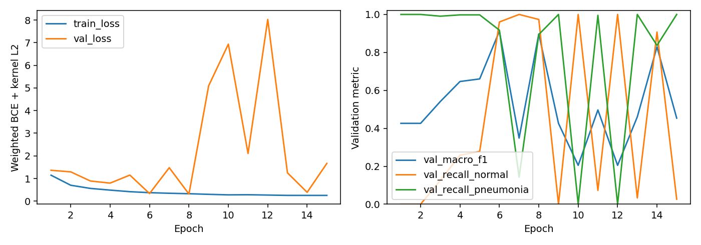
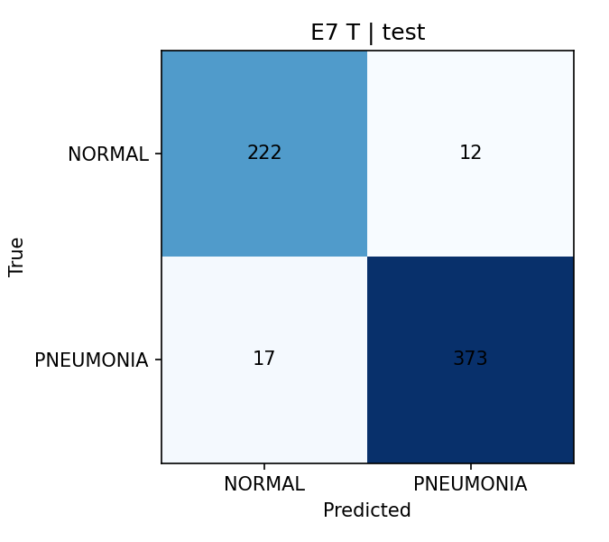
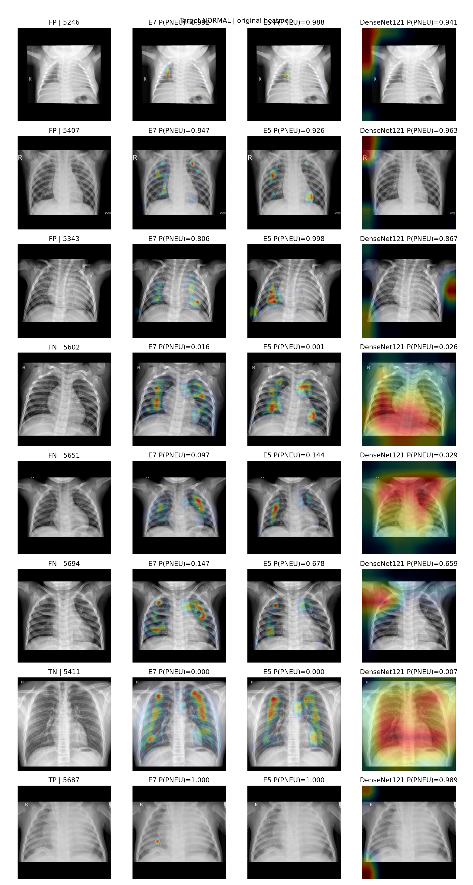
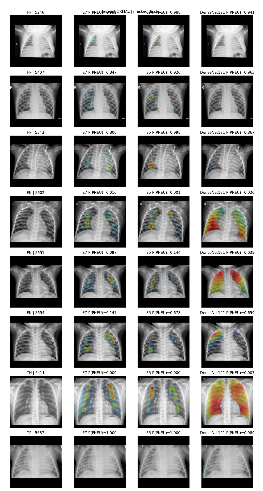
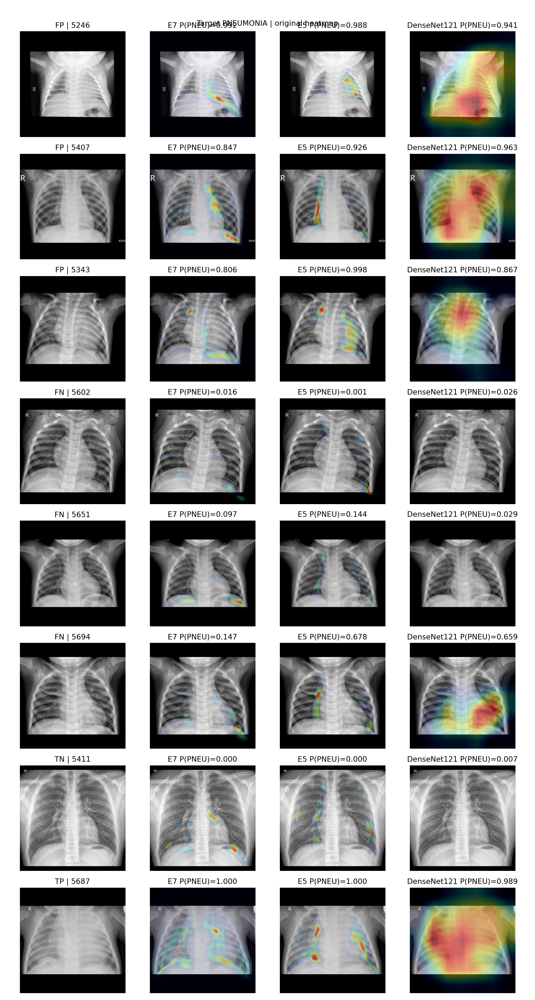
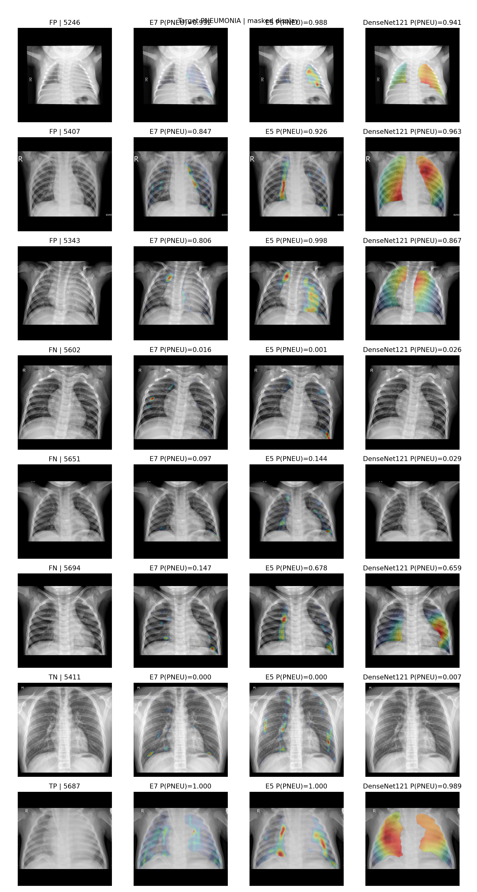

# PneuNet Reproduction and Improvements

Klasifikasi NORMAL dan PNEUMONIA pada chest X-ray menggunakan PneuNet E7_T, yaitu E7-B dengan Global Response Normalization sebelum normalized learnable spatial pooling. Repository ini memuat implementasi, notebook dengan output tersimpan, hasil evaluasi, dan rangkaian ablasi yang mendasari eksperimen.

Hasil E7_T yang dilaporkan berasal dari kandidat T, seed 42, checkpoint epoch 6, dengan **229,544 parameter**, **accuracy test 95.3526%** dan **F1 macro test 95.0635%** pada 624 citra. Ambang keputusan adalah 0,5. [Metrik sumber](outputs/test_metrics.json) · [Metadata pemilihan](outputs/selection.json)

## Isi repository

```text
PneuNet_E7_T_Repo/
  README.md
  E7B15_Final.ipynb
  pneunet_e7_t.py
  preprocess_p3.py
  train_pneunet_e7_t.py
  report_e7_t.py
  benchmark_e7_t_latency.py
  requirements.txt
  docs/        penjelasan metode dan panduan reproduksi
  data/        metadata sumber, rencana augmentasi dan checksum
  outputs/     seluruh hasil E7_T yang dapat dibagikan
  ablation/    empat notebook dan folder output masing-masing
  manifests/   inventaris file, checksum dan catatan pengecualian
```

Setiap folder memiliki README yang menjelaskan isinya. Dataset, cache tensor citra, mask mentah dan semua bobot model tidak disertakan. Kode arsitektur tetap disertakan. Gambar contoh pada visualisasi merupakan bagian laporan eksperimen. File NPZ yang disimpan hanya berisi heatmap Grad-CAM dan indeks contoh.

## Classification report E7_T

Precision, recall dan F1 pada tabel berikut memakai skala 0–1. Support adalah jumlah citra. Laporan train dan validation juga tersedia di outputs/.

| Kelas / agregat | Precision | Recall | F1 | Support |
|---|---:|---:|---:|---:|
| NORMAL | 0.9289 | 0.9487 | 0.9387 | 234 |
| PNEUMONIA | 0.9688 | 0.9564 | 0.9626 | 390 |
| macro avg | 0.9489 | 0.9526 | 0.9506 | 624 |
| weighted avg | 0.9538 | 0.9535 | 0.9536 | 624 |

[Classification report JSON](outputs/test_report.json) · [Prediksi setiap citra test](outputs/test_predictions.csv)

## Learning curve

Kurva berasal dari history.csv eksperimen arsip. E7_T selesai pada epoch 15 dan checkpoint terpilih berada pada epoch 6. Pemilihan epoch memakai validation macro-F1, sedangkan early stopping memakai validation loss.



[Riwayat per epoch](outputs/history.csv)

## Confusion matrix

Baris menunjukkan label sebenarnya dan kolom menunjukkan prediksi. NORMAL = 0, PNEUMONIA = 1. Dari 624 citra, terdapat 222 true negative, 12 false positive, 17 false negative dan 373 true positive.



[Confusion matrix CSV](outputs/test_confusion_matrix.csv) · [Train](outputs/train_confusion_matrix.png) · [Validation](outputs/val_confusion_matrix.png)

## Grad-CAM

Visualisasi arsip menampilkan E7_T bersama E5 dan DenseNet121 pada contoh yang sama. Target NORMAL dan PNEUMONIA ditampilkan terpisah. Gunakan versi asli untuk melihat seluruh heatmap. Versi lung_mask membatasi tampilan heatmap dengan mask paru dan perlu dibaca sebagai tampilan tambahan, bukan bukti tersendiri bahwa seluruh atribusi asli berada di paru.

### Target NORMAL



<details>
<summary>Tampilan dengan mask paru untuk target NORMAL</summary>



</details>

### Target PNEUMONIA



<details>
<summary>Tampilan dengan mask paru untuk target PNEUMONIA</summary>



</details>

[Daftar contoh](outputs/test_cases.csv) · [Rasio atribusi di area paru](outputs/gradcam_lung_attribution.csv) · [Array heatmap](outputs/gradcam_original_heatmaps.npz)

## Benchmark klasifikasi dan latency

Metrik klasifikasi berasal dari final_comparison.csv pada test P3 yang sama. Latency di bawah berasal dari pengukuran lima model pada run A100 yang sama, bukan gabungan latency historis dari eksperimen berbeda.

| Model | Parameter | Accuracy (%) | F1 macro (%) | Mean batch 1 (ms) | Median batch 1 (ms) | Median batch 32 (ms) |
|---|---:|---:|---:|---:|---:|---:|
| E7 T | 229,544 | 95.3526 | 95.0635 | 34.12 | 11.11 | 88.11 |
| PneuNet_E5_P3 | 785,192 | 93.9103 | 93.4095 | 30.63 | 12.09 | 102.46 |
| DenseNet121_RSNA | 6,948,609 | 95.3526 | 95.0122 | 88.09 | 96.74 | 99.19 |
| RAD_DINO | 86,581,249 | 92.9487 | 92.5636 | 72.31 | 85.68 | 154.42 |
| DINOv3_ViTL16 | 303,130,625 | 95.0321 | 94.7401 | 170.10 | 181.58 | 441.96 |

Pengukuran memakai **NVIDIA A100-SXM4-80GB**, input **224 × 224**, FP32, AMP dan TF32 mati, serta CUDA Events pada input yang sudah berada di GPU. Setiap batch memakai 3 sesi, 30 warmup dan 100 pengukuran per sesi, sehingga terdapat 300 sampel. Waktu baca data, segmentasi, preprocessing di CPU, loading model dan transfer input tidak termasuk. Waktu batch 32 adalah waktu satu batch, bukan waktu per gambar.

GPU dipakai bersama. Aktivitas proses lain terdeteksi pada **368 dari 390 sampel pemantauan**, sehingga mean dan median dilaporkan bersama agar variasi waktunya terlihat. Hasil ini tidak diperlakukan sebagai benchmark GPU senggang.

[Klasifikasi seluruh model](outputs/final_comparison.csv) · [Latency lengkap](outputs/latency/20261120T023942_313817Z_y7u3yg4f/latency_summary.csv) · [Metadata GPU](outputs/latency/20261120T023942_313817Z_y7u3yg4f/environment.json) · [Benchmark P3 sebelumnya](ablation/benchmark_P3_seed42.ipynb)

## Rangkaian ablasi

Notebook disalin beserta output sel yang tersimpan. Keempat folder hasil mempertahankan isi CSV, JSON, PNG, NPZ heatmap dan snapshot notebook yang tersedia. Bobot model serta salinan otomatis .ipynb_checkpoints dikecualikan. [Panduan folder ablation](ablation/README.md)

| Notebook / studi | Percobaan | Hasil tersimpan |
|---|---|---|
| [Segmentasi paru-paru](ablation/PneuNet_E5_3Level_Segmentation_Ablation_FIXED.ipynb) | Dua segmenter, tiga perlakuan ROI, P1–P3 dan kontrol tanpa segmentasi. Tahap awal memiliki 21 konfigurasi seed 42. Bagian lanjutan menguji hard mask U-Net pada P1–P4 dengan seed 42, 123, dan 3407. | [Output](ablation/output_pneunet_e5_segmentation_3level/) |
| [Faktorial CLAHE × augmentasi](ablation/PneuNet_E5_Factorial_2x2_CLAHE_Augmentation.ipynb) | Empat kondisi E5: baseline, CLAHE saja, augmentasi saja, serta CLAHE + augmentasi. Seluruh kondisi memakai normalisasi /255 agar skala intensitas sama. | [Output](ablation/output_pneunet_e5_factorial_2x2/) |
| [Ablasi preprocessing E5](ablation/reproduce_pneunet_e5_data_ablation_batch32.ipynb) | Lima kondisi dengan arsitektur E5 dan batch fisik 32: RAW 0–255, normalisasi /255, CLAHE, rotasi 50% train, dan Gaussian blur 50% train. Rotasi dan blur tidak diterapkan pada validation/test utama. | [Output](ablation/output_pneunet_e5_data_ablation_batch32/) |
| [Benchmark model pada P3](ablation/benchmark_P3_seed42.ipynb) | PneuNet E5 P3 seed 42 dibandingkan dengan DenseNet121-RSNA, RAD-DINO dan DINOv3 ViT-L/16 pada split yang sama. Notebook ini juga memuat evaluasi, atribusi, VRAM dan efisiensi GPU. | [Output](ablation/output_benchmark_P3_seed42/) |

P1 dan P4 pada studi segmentasi memakai /255. P2 dan P3 studi tersebut memakai skala 0–255. Seluruh jalur faktorial 2×2 memakai /255. Oleh karena itu, nama kondisi yang mirip antar-notebook tidak selalu memiliki skala input yang sama.

## Membaca dan mereproduksi hasil

Buka [E7B15_Final.ipynb](E7B15_Final.ipynb) untuk membaca hasil E7_T tanpa menjalankan training. Notebook ablasi tetap mempertahankan konfigurasi riset dan output historisnya. Baca hasil tersimpan tanpa Run All. Notebook besar dapat dibuka menggunakan Jupyter apabila pratinjau GitHub tidak tersedia.

Untuk training atau inferensi baru, siapkan dataset, mask dan bobot yang diperlukan di lingkungan lokal. Lihat [panduan reproduksi](docs/REPRODUCTION.md), [metode dan arsitektur](docs/METODE_DAN_ARSITEKTUR.md), serta [dependensi utama](requirements.txt). Tidak ada training atau benchmark baru yang dijalankan saat menyiapkan folder repository ini.

## Cara membaca hasil penelitian

Epoch terbaik T dipilih melalui validation. Namun, metadata arsip mencatat bahwa test pernah digunakan dalam pemilihan kandidat arsitektur. Hasil E7_T ini merupakan hasil eksploratif dan test tersebut tidak menjadi holdout independen baru. Selisih F1 macro terhadap DenseNet121-RSNA sekitar 0,0513 poin persentase pada 624 citra dan bukan bukti signifikansi statistik. Generalisasi pada seed dan dataset lain masih perlu diuji. Catatan asli dipertahankan pada outputs/selection.json dan outputs/test_outcome.json.

## Kesiapan Git

.gitignore mengecualikan dataset, cache dan model tanpa pengecualian untuk checkpoint arsip. [Inventaris artefak](manifests/artifact_inventory.csv) memuat checksum salinan, dan [catatan pengecualian](manifests/excluded_artifacts.csv) menjelaskan file yang sengaja tidak disalin. Repository public: [arsyad429/pneunet-reproduction-and-improvements](https://github.com/arsyad429/pneunet-reproduction-and-improvements). [Inventaris publikasi](manifests/publication_inventory.csv) mencatat ukuran dan checksum versi file yang dipublikasikan.
